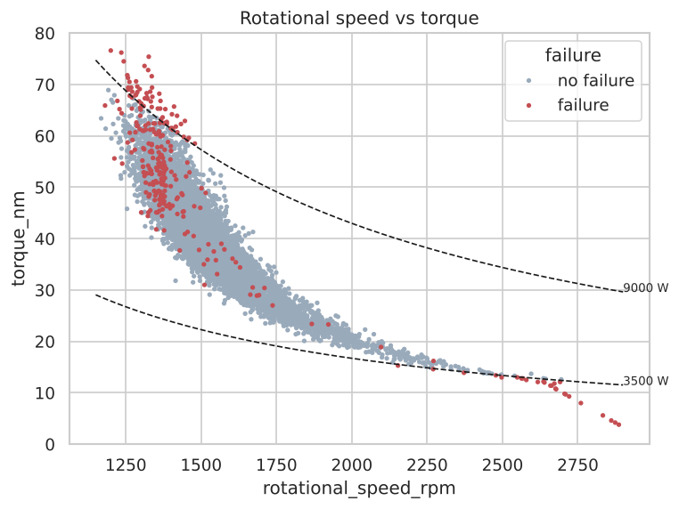
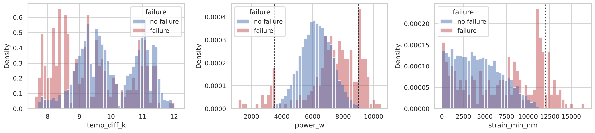
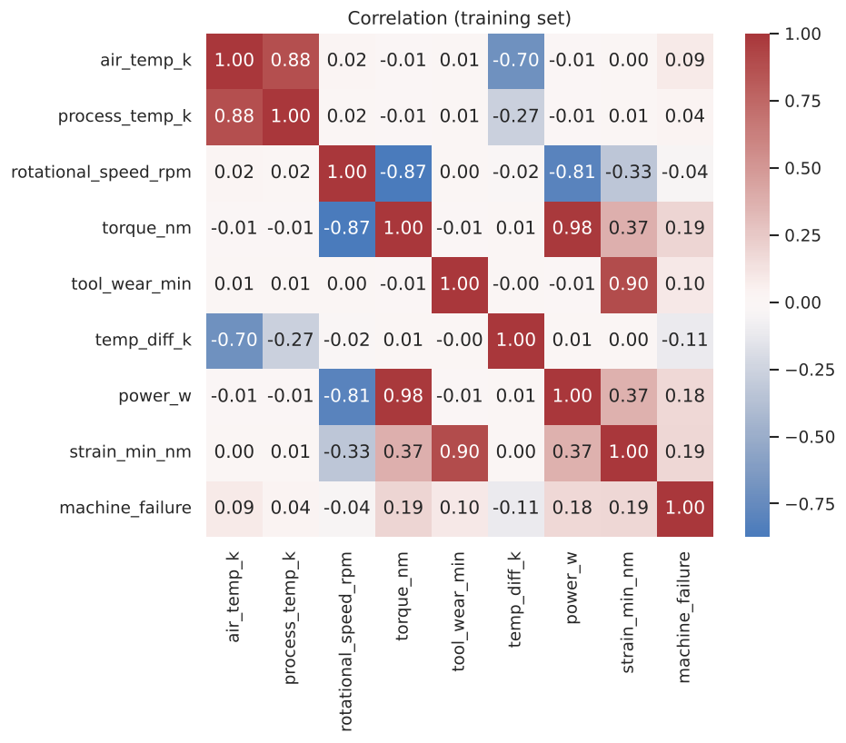
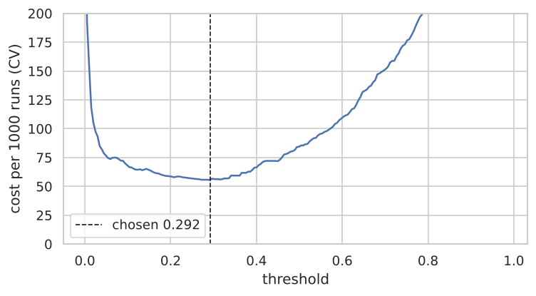
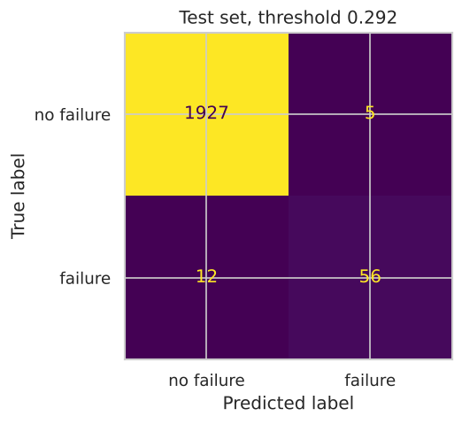
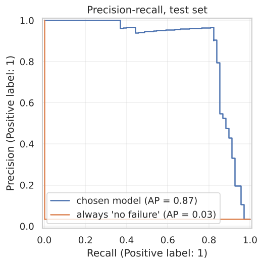
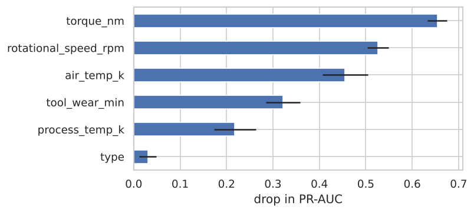

# 1. Problem

The project predicts, from the parameters of one machining run, whether the
run will end with a machine failure. The user is the maintenance department,
which decides whether to stop the process and inspect the machine before the
run.

* **Task:** binary classification, target `Machine failure` (0/1).
* **Observation:** one process run - product variant, air and process
  temperature, rotational speed, torque and tool wear - with its label.
* **Output:** failure probability, a decision at a cost-based threshold, and
  physically meaningful derived values (temperature difference, power, tool
  strain).

The course card and the final project specification require classification,
while the list of topics in the exercises also allows regression; a
classification task satisfies both sources.

# 2. Data

**Source.** AI4I 2020 Predictive Maintenance Dataset, UCI Machine Learning
Repository, DOI 10.24432/C5HS5C, licence CC BY 4.0; source paper: S. Matzka,
*Explainable Artificial Intelligence for Predictive Maintenance Applications*,
AI4I 2020. The file `data/raw/ai4i2020.csv` (10 000 rows, 14 columns) is kept
unchanged; `data/SOURCE.md` records the attribution, the download date and the
SHA-256 checksum, which the code verifies before every load. The data are
synthetic and contain no personal data.

**Columns.** `UDI` and `Product ID` are identifiers; `Type` (L/M/H) and five
measured parameters are features; `Machine failure` is the label; the flags
`TWF`, `HDF`, `PWF`, `OSF` and `RNF` describe the failure mode and define the
label, so they are excluded from the features (they would be leakage) and used
only in the error analysis. Column names are converted to snake_case in one
place (`ml/data.py`).

**How the label was generated** (UCI description): tool wear failure (TWF) at a
random moment at 200-240 min of wear; heat dissipation failure (HDF) when the
process-air temperature difference is below 8.6 K and speed below 1380 rpm;
power failure (PWF) when power is below 3500 W or above 9000 W; overstrain
failure (OSF) when tool wear times torque exceeds 11 000 / 12 000 / 13 000
minNm for L / M / H; random failure (RNF) with probability 0.1%.

# 3. Data quality and analysis

**Quality.** No missing values, no duplicate rows (also after removing the
identifiers), `UDI` and `Product ID` unique, the first letter of `Product ID`
always equals `Type`. There are 339 failures (3.39%); a model that always says
"no failure" has 96.61% accuracy. Failure rate by variant: L 3.92% (6000 runs),
M 2.77% (2997), H 2.09% (1003). Values outside 1.5 IQR appear only for speed
(418) and torque (69); they are physically plausible and are exactly where
power failures happen, so nothing is removed.

**Label consistency.** The HDF, PWF and OSF rules recomputed from the inputs
reproduce the flags in all 10 000 rows and explain 287 of 339 failures (84.7%).
The remaining 52 are 43 with a TWF flag and 9 without any flag. The file
differs from the UCI description:

| Element | UCI description | File |
|---|---|---|
| TWF | 120 cases, 51 failures; window 200-240 min | 46 flags; wear at flag 198-253 min |
| RNF | 5 cases | 19 flags, only 1 with a failure |
| Label | failure = at least one mode | 9 failures without a flag; 18 RNF flags without failure |

Decision: `Machine failure` stays the label unchanged, because it is the
target; the discrepancies are a limitation of the data (section 10) and the
unflagged failures are tracked in the error analysis.

**Exploratory analysis** (training set only, after the split):

{width=75%}

Observations: (1) failures are concentrated at the extremes - high torque at
low speed, very low torque at high speed, high tool wear; (2) the derived
features separate the classes far better than the raw columns - failures pile
up below 8.6 K, outside the 3500-9000 W band and above the strain limits;
(3) air and process temperature are strongly correlated (0.88), and torque and
speed strongly negatively correlated (-0.87), so raw columns are partly
redundant and their combinations carry the signal.

{width=70%}

# 4. Data preparation

* The stratified 80/20 split (`random_state=42`) is the first operation after
  the quality checks: 8000 training runs (271 failures) and 2000 test runs
  (68 failures).
* All transformations are steps of a scikit-learn `Pipeline`: selecting the
  six inputs, computing derived features with a `FunctionTransformer`,
  one-hot encoding `Type`, and scaling numeric columns (logistic regression
  only). In cross-validation they are therefore fitted on the training part
  of each fold only.
* Two feature sets: **raw** (type and five parameters) and **physics** (raw
  plus `temp_diff_k = process - air temperature`, `power_w = torque * rpm *
  2*pi/60`, `strain_min_nm = tool wear * torque`). The derived features use
  only values known before the run - domain knowledge, not leakage. Because
  they live in the Pipeline, the application passes raw values and the same
  code computes them.

# 5. Models

All models were evaluated on both feature sets with the same
`StratifiedKFold(5, shuffle=True, random_state=42)` folds; small grids were
tuned by `GridSearchCV` with PR-AUC (average precision) as the score.

| Model | Configuration | Grid |
|---|---|---|
| Dummy | most frequent class | - |
| Logistic regression | scaler + one-hot, balanced classes, max_iter 2000 | C in {0.1, 1, 10} |
| Decision tree | balanced classes | max_depth in {3, 4, 5, 6, 8} |
| Random forest | 300 trees, balanced_subsample | - |
| Hist gradient boosting | default | learning_rate in {0.05, 0.1}, max_depth in {3, None} |

Cross-validated results (mean +/- standard deviation over 5 folds; recall,
precision and accuracy at the default 0.5 threshold):

| Model | Features | PR-AUC | ROC-AUC | Recall | Precision | Accuracy |
|---|---|---|---|---|---|---|
| Hist gradient boosting | physics | 0.898 +/- 0.024 | 0.983 | 0.804 | 0.928 | 0.991 |
| Random forest | physics | 0.892 +/- 0.025 | 0.975 | 0.749 | 0.981 | 0.991 |
| Hist gradient boosting | raw | 0.812 +/- 0.040 | 0.973 | 0.672 | 0.840 | 0.984 |
| Decision tree (depth 5) | physics | 0.792 +/- 0.038 | 0.940 | 0.923 | 0.410 | 0.952 |
| Random forest | raw | 0.760 +/- 0.033 | 0.969 | 0.391 | 0.936 | 0.978 |
| Decision tree (depth 8) | raw | 0.572 +/- 0.065 | 0.849 | 0.712 | 0.361 | 0.947 |
| Logistic regression | physics | 0.486 +/- 0.026 | 0.916 | 0.838 | 0.159 | 0.844 |
| Logistic regression | raw | 0.446 +/- 0.025 | 0.897 | 0.804 | 0.137 | 0.822 |
| Dummy | either | 0.034 +/- 0.000 | 0.500 | 0.000 | 0.000 | 0.966 |

The physics features improve every model. ROC-AUC is high for almost every
model and hides differences that PR-AUC shows; accuracy ranks the useless
baseline above logistic regression.

# 6. Threshold and model choice

**Threshold.** A missed failure is assumed to cost ten times a false alarm.
`TunedThresholdClassifierCV` chooses the threshold that minimises
`10*FN + FP` (per 1000 runs) on training folds. To estimate the quality of the
whole procedure, it was wrapped in an outer cross-validation (each outer fold
tunes its own threshold on inner folds):

| Model | Features | Recall | False alarms / 1000 | Cost / 1000 | Threshold (std) | Latency |
|---|---|---|---|---|---|---|
| Random forest | physics | 0.849 | 5.6 | 56.9 +/- 11.6 | 0.248 (0.055) | 60 ms |
| Hist gradient boosting | physics | 0.856 | 10.2 | 59.0 +/- 11.9 | 0.147 (0.044) | 7 ms |
| Decision tree | physics | 0.804 | 14.2 | 80.5 +/- 17.2 | 0.726 (0.285) | 5 ms |
| Hist gradient boosting | raw | 0.860 | 34.8 | 82.2 +/- 15.5 | 0.062 (0.029) | 5 ms |
| Random forest | raw | 0.819 | 24.9 | 86.1 +/- 9.5 | 0.154 (0.019) | 65 ms |
| Logistic regression | physics | 0.639 | 56.0 | 178.5 +/- 22.3 | 0.722 (0.049) | 4 ms |

**Choice: random forest on physics features**, not by one number:

* its PR-AUC equals that of gradient boosting within a quarter of one
  standard deviation, so the main metric does not separate the two leaders;
* at the cost-based threshold it has the lowest cost, the same recall and half
  the false alarms (5.6 vs 10.2 per 1000 runs) - fewer alarms matter for a
  maintenance team that must react to each one;
* its results are more stable between folds (std of false alarms 3.0 vs 6.2);
* the decision tree is interpretable but 40% more expensive and its threshold
  is unstable, so it is kept as an explanation model (section 7);
* the cost is speed (60 ms instead of 7 ms per prediction), irrelevant for
  interactive use.

The final model is the random forest pipeline wrapped in
`TunedThresholdClassifierCV`, fitted on the whole training set; the threshold
is **0.292**.

**Sensitivity to the cost ratio** (threshold chosen on training folds; test
columns computed after the choice was frozen):

| FN:FP | Threshold | CV cost / 1000 | Test recall | Test false alarms | Test cost / 1000 |
|---|---|---|---|---|---|
| 5:1 | 0.316 | 29.1 | 0.824 | 5 | 32.5 |
| 10:1 | 0.292 | 55.6 | 0.824 | 5 | 62.5 |
| 20:1 | 0.054 | 106.3 | 0.912 | 96 | 108.0 |

Between 5:1 and 10:1 the decision barely changes; at 20:1 the model buys six
more detected failures with 91 more false alarms. The ratio is a business
decision to agree with maintenance.

{width=65%}

# 7. Evaluation on the test set

The test set was used once, after the choice and threshold were frozen:

| Metric | Random forest (threshold 0.292) | Always "no failure" |
|---|---|---|
| PR-AUC | 0.871 | 0.034 |
| ROC-AUC | 0.970 | 0.500 |
| Recall | 0.824 (56 of 68) | 0.000 |
| Precision | 0.918 | - |
| F1 | 0.868 | 0.000 |
| False alarms / 1000 runs | 2.5 (5) | 0.0 |
| Cost / 1000 runs | 62.5 | 340.0 |
| Accuracy | 0.992 | 0.966 |

The test PR-AUC is within one standard deviation of the CV estimate
(0.892 +/- 0.025), and so is the cost (56.9 +/- 11.6).

{width=40%}
{width=55%}

**Error analysis** (failure-mode flags used only here):

| Cause | Failures | Detected | Missed | Recall |
|---|---|---|---|---|
| HDF | 29 | 28 | 1 | 0.966 |
| PWF | 12 | 12 | 0 | 1.000 |
| OSF | 16 | 16 | 0 | 1.000 |
| TWF | 9 | 0 | 9 | 0.000 |
| no flag | 2 | 0 | 2 | 0.000 |
| all | 68 | 56 | 12 | 0.824 |

Failures produced by deterministic rules are found in 56 of 57 cases; the one
miss is an HDF case at the very edge of the rule (temperature difference
8.6 K, probability 0.20). Tool wear failures happen at a random moment in the
wear window, so the inputs only say that the tool is old; the two unflagged
failures are explained by nothing in the data. The share of test failures
explained by the rules (83.8%) is the realistic ceiling for recall from these
inputs, and the model reaches 82.4% - the rest of the error is irreducible
with these data. All 5 false alarms are near misses at rule boundaries
(temperature difference 8.6 K at low speed, strain 10 941 minNm just under
the 11 000 limit, power 8958 W close to 9000 W).

**Explainability.** Permutation importance on the test set (drop in PR-AUC):
torque 0.65, rotational speed 0.53, air temperature 0.46, tool wear 0.32,
process temperature 0.22, type 0.03.

The depth-5 decision tree, which never saw the rules or the flags, split at
1380 rpm and 8.55 K (HDF: 1380 rpm, 8.6 K), at 3496 W and 8995 W (PWF: 3500
and 9000 W) and at 11 014 minNm (OSF limit for type L, the most common
variant). The model rediscovered the mechanism that generated the data; the
higher OSF limits for types M and H were not found at this depth.

{width=60%}

# 8. Application

* **Core** `ml/predictor.py`, shared by both interfaces. It compares the
  SHA-256 of `models/model.joblib` with `models/model_card.json` before
  loading, because joblib files are pickles and can execute code. It
  validates the input, predicts, computes derived values and logs the call.
* **Validation** `ml/validation.py` (Pydantic). Hard: type in {L, M, H},
  finite numbers, temperatures and speed > 0, torque and wear >= 0 - otherwise
  the input is rejected with a readable message. Soft: a value outside the
  training range stored in the model card is predicted with an "out of range"
  warning.
* **Streamlit** `app.py`: form with training ranges as hints, probability and
  decision, derived values, out-of-range warning, history with a filter, CSV
  export, model information. The model is cached with `st.cache_resource`.
* **Console** `cli.py`: interactive prompts repeated on invalid values,
  `--history N`, `--export file.csv`, `--batch file.csv`.

# 9. Database and documentation

SQLite table `predictions`: id, time (UTC, ISO 8601), model id, source
(streamlit, cli, batch), inputs as JSON, probability, threshold, decision,
out-of-range flag, latency. Only parameterised queries are used (a test
stores an SQL injection string as plain text), a connection is opened per
operation, and no user data are stored - only what is needed to audit the
predictions. The model id allows old predictions to be attributed to the
model that made them after retraining.

The repository contains a README (installation, running, reproduction,
tests), the executed notebook, this report, `docs/defense.md` with questions
and answers on every decision, `docs/demo.md` with the demo script, and 55
automated tests (data checksum, leakage, feature formulas, validation, model
save and reload, predictor, database, console and Streamlit app).
`python -m ml.train` reproduces the model deterministically from the raw file.

# 10. Limitations and future work

**Limitations:**

* The data are synthetic: failures follow a few simple rules with sharp
  boundaries, much simpler than in a real plant. Excellent results here do not
  transfer to real machines without real data.
* Part of the label is random by definition (RNF and the timing of TWF) and 9
  failures have no flag at all; this part of the error cannot be removed.
* The file differs from the UCI description (TWF and RNF counts, unflagged
  failures); the label was not corrected.
* The threshold depends on the assumed 10:1 cost ratio; the sensitivity
  analysis shows how the behaviour changes.
* Each run is treated independently; there is no history of sensor readings
  over time.
* The model predicts that a failure will happen, not which mode will cause
  it.
* Process note: during development the training script was once run end to
  end with gradient boosting as a placeholder choice and printed its test
  metrics (PR-AUC 0.903, recall 0.853) before the cross-validated comparison
  was complete. The final choice was made from cross-validation only and was
  not changed after the test evaluation, even though gradient boosting
  happened to score slightly better on the test set.

**Future work:** real data with sensor time series and features computed from
them; classification of the failure type; storing the actual outcome of each
run in the database to monitor model quality over time; agreeing the cost
ratio with the maintenance team.
